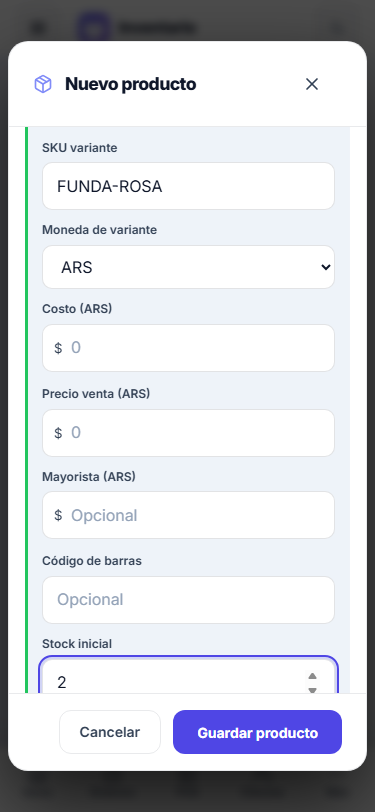
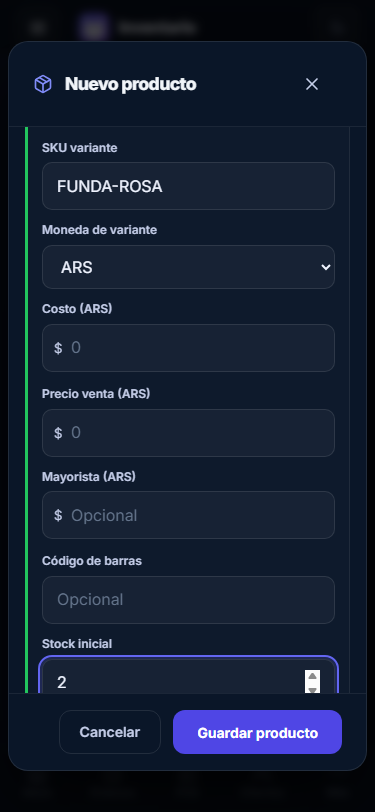
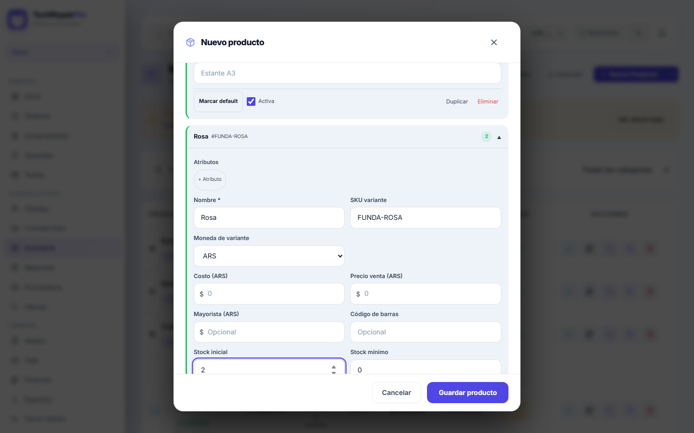
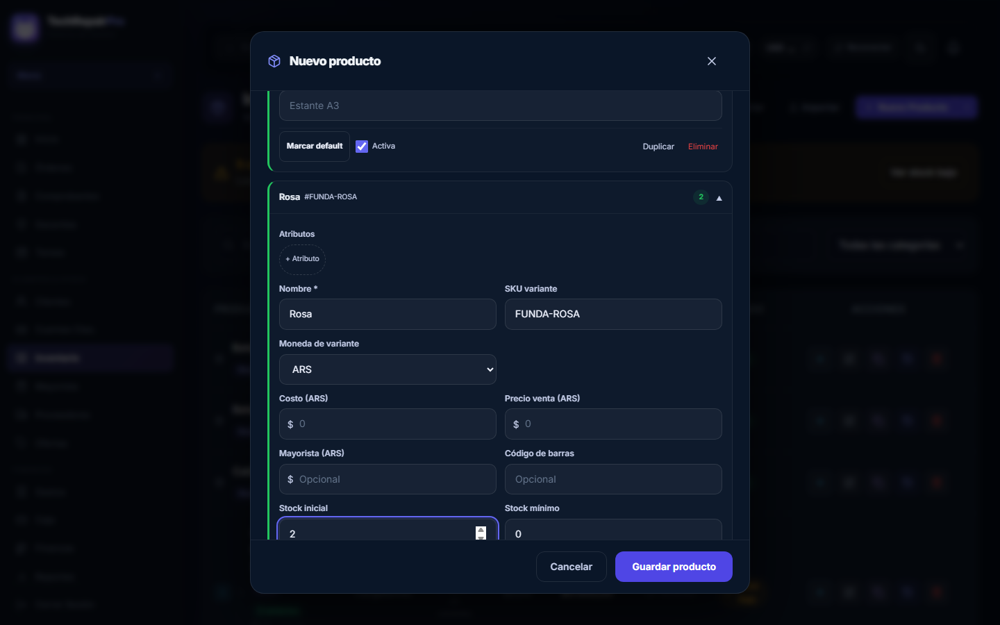

# PRODUCT-VARIANTS-1 — Variantes V2 seguras

Branch: `codex/product-variants-v2`. Base solicitada: `6ef066d5bc3e28ed56e94c1587be584c48f7e0a0`.
El PR y su SHA final se informan en la entrega. Sin merge, despliegue, `db push` ni cambios en producción.

## Integración final con main / BUTTON-SYSTEM-1A

La rama se rebasó sobre `f0f72acf6a8dacff06668bca4f83fa04c7879ab1` (merge certificado de #177). No hubo conflictos de Git; sí había un conflicto de intención entre el microfix histórico del CTA y la nueva autoridad de botones. Los cuatro CTAs primarios del modal ahora reutilizan `.btn-primary`, sin fondo ni sombra en línea: `--indigo-600` en reposo, `--indigo-700` en hover, sin gradientes/glow. Conservan el token de texto, disposición, accesibilidad y tamaños de modal. Las acciones de página y `.btn-page-action` de main permanecen intactas.

La expectativa antigua de gradiente para esos CTAs seguía en el archivo BETA-UX-1E de main; se actualizó para exigir la clase canónica, ausencia de overrides de fondo/sombra y el token de texto. Los contratos actuales de BUTTON-SYSTEM-1A y sus valores de contraste no se relajaron. El guard de variantes agrega tres mutantes: gradiente, glow y pérdida de clase canónica (17 controles en total).

El servicio `productService.ts` y la migración coinciden exactamente con el SHA certificado anterior. Se preserva la identidad tenant-scoped de `updateProduct`, así como stock, retry, relaciones, compatibilidad legacy y precios/costos. Entre la base anterior y este main no se incorporaron migraciones: las de Mercado Pago y G2-C.3A3 ya estaban en la base anterior, y no cambian los objetos ni dependencias de esta migración.

La certificación se ejecuta de nuevo sobre esta base, sin reutilizar el verde anterior. Se amplía la matriz visual del modal a 375×812 y 1440×900, claro/oscuro, verificando fondo sólido, hover, ausencia de glow, controles de 44px y ausencia de overflow. Los resultados de tests, capturas revisadas y CI completo del nuevo SHA se informan en la entrega. No se aplicó ninguna migración adicional al entorno existente ni a producción; las matrices CI usan bases descartables.

Antes del push pasaron 684 pruebas de componentes (BETA-UX-1E/1F, BUTTON-SYSTEM-1A, variantes y A2), TypeScript, lint sin errores, los 17 mutantes de variantes, 38 de A2, 92 de A3 y 47 de SEC-08B. Se revisaron las cuatro capturas reales nuevas incluidas abajo. El entorno local tenía el puerto de su gateway reservado por Windows; para la validación se utilizó un puente temporal sólo en localhost:55421, permitido por el guard existente, sin relajarlo ni cambiar migraciones.

## Discovery y alcance

Se reutilizaron ProductFormModal, VariantSelector, productService y el generador existente. Se leyeron la autoridad de Product Design y sus referencias de contexto, sistema visual, seguridad de ingeniería y calidad. POS mantiene su diseño protegido; Mi Guita no se usa como referencia.

El catálogo local y las migraciones confirman `inventory.parent_id`, `has_variants`, `variant_name`, `product_variants.product_id` y `inventory_item_id`. El esquema de variantes ya tenía RLS pero **ningún permiso de API para authenticated**. El alta real reprodujo `permission denied for table product_variants`; por eso la migración acotada es indispensable.

## Modelo y stock

- Padre: `inventory.has_variants=true`, `parent_id=null`, saldo cero. Agrupa y sirve para buscar; no se vende ni recibe ajustes propios. Su suma de hijos es sólo presentación.
- Hijo: inventario independiente con `parent_id=padre.id`, `has_variants=false`, nombre de variante, SKU, barcode, costos, precios, moneda, cotización, ubicación, mínimo y estado propios.
- Metadata: `product_variants.product_id` y `inventory_item_id` enlazan la familia y su hijo; conservan atributos, default y orden.
- Única autoridad de saldo: **inventory.stock_quantity**, mediante A1 para stock no documental y writers canónicos para documentos. No se modificaron A1/A3 ni sus writers, grants de stock o libro append-only.
- `product_variants.stock` queda deprecated: altas por su default cero, sin permisos de lectura/escritura de API. Selector y picker consultan el inventario vinculado. Un valor histórico en esa columna nunca decide disponibilidad.

## Alta, rollback y recuperación

Primero se valida la familia y se crean todas las definiciones sin campos de stock. Luego se intenta un solo batch `initial_stock`, con IDs de hijos, deltas y clave `initial-stock:<padre>`.

Antes del batch se limpian únicamente los IDs creados por ese intento. Si la política existente no permite borrado físico, las filas retenidas se desactivan por las capacidades existentes; no se amplían permisos de borrado de inventario. Después de intentar el batch no se ejecuta cleanup destructivo, aunque se pierda la respuesta.

La recuperación conserva padre, hijos, deltas, motivo y la misma clave; retry sólo ejecuta A1. El formulario congela metadata y bloquea doble submit con una referencia síncrona. Guarda recuperación y valores visibles en sessionStorage por negocio, y puede reabrirse en la misma sesión sin recrear la familia. El alta posterior de un hijo también conserva un retry propio con `initial-stock:<hijo>`.

Mensaje: “El producto y sus variantes se crearon, pero no pudimos confirmar el stock inicial. Reintentar no duplica el producto.”

## Superficies

| Superficie | Comportamiento |
| --- | --- |
| Inventario | Menú Producto / Servicio / Con variantes; padre expandible y total visual de hijos activos; acciones de edición, movimientos, alta y baja lógica por hijo; reactivación explícita. Duplicar V2 crea vínculos nuevos y saldo cero. |
| POS | Conserva búsqueda canónica, padre → hijos, SKU exacto, rechazo de padre y compatibilidad `parent_id`, `variant_parent:` y `VPREF-`. La venta descuenta el hijo seleccionado. Sin cambios visuales en POS. |
| Órdenes | Mismo contrato de búsqueda y selección vendible; etiqueta familia/variante e ID del hijo en `order_items.product_id`. |
| Mayorista | Excluye padres marcados; muestra identidad de variante y conserva ambos aliases de precio (`wholesale_price_ars` y `precio_mayorista`). Portal conserva stock positivo y visibilidad existentes. No cambia su writer de pedidos. |
| USD | Referencia de venta USD en `base_price`, costo USD separado, cotización y actualización automática por hijo; padre sin repricing automático. Una variante USD puede heredar costo ARS por conversión. Overrides y ceros explícitos se conservan. |
| Generador | Dimensiones completas y únicas, valores deduplicados, máximo 100 combinaciones; combina con filas manuales sin reemplazar ediciones. Se pueden editar nombres, SKU, atributos y valores propios. |
| Valores base | Reutiliza applyBaseToVariants para completar huecos sin pisar cambios individuales; conversiones con cotización válida, mínimo y ubicación heredables. |
| Mobile / temas | 375 px, filas de campos en una columna, textos largos sin desbordar, controles/touch targets de 44 px, foco visible y selector con Escape, ciclo de Tab y restauración de foco. CTAs primarios reutilizan el índigo sólido y hover de BUTTON-SYSTEM-1A con el token de texto certificado. |

## Migración preparada

`supabase/migrations/20261014120000_product_variants_v2_metadata_access.sql`:

- No DML, backfill ni reconciliación de historia.
- Permisos por columna y tenant/capacidad; costos crudos y stock legado fuera de SELECT.
- Vínculo único de metadata por hijo; rechaza huérfanos, inventario no vinculado y relaciones entre negocios. Links/tenant no son editables por API.
- Padre V2 nuevo siempre raíz y saldo cero; no se puede quitar su identidad agrupadora para venderlo.
- Guard histórico contra borrado físico de metadata con stock/movimientos, conservando el purge canónico del tenant.
- Padres históricos con saldos previos pueden editar metadata sin reparación automática ni movimiento de stock.
- Requiere A1 y A3. Aborta si hay vínculos duplicados, sin corregirlos automáticamente.

**Debe aplicarse por el proceso autorizado antes del frontend productivo. Aquí sólo se probó en un contenedor local.** Ese contenedor estaba atrasado y se completaron allí las migraciones de stock existentes de G2-B a A3; no se aplicaron migraciones ARCA/MP ni se accedió a producción. La fecha/version del archivo se ubica después de la última migración de la base solicitada para evitar colisiones del ledger.

El frontend V2 necesita los permisos y guards de `product_variants`, por lo que la migración debe estar aplicada **ANTES** de que llegue a producción. No se debe usar «merge y después db push» como secuencia de rollout. Antes del deploy productivo se ejecutarán manualmente `supabase migration list` y `supabase db push --dry-run` para revisar exactamente las migraciones pendientes; esos comandos no se ejecutaron durante este microfix. El repo incluye `20261013120000_beta_mp_plan_b_session_preapproval_unique.sql` además de esta migración: no corresponde hacer un `db push` a ciegas ni aplicar Mercado Pago junto con este lote.

## Microfix histórico del PR #176 (antes de BUTTON-SYSTEM-1A)

El CI del primer SHA falló en «Producto · Guardar producto» de BETA-UX-1E: el CTA había cambiado incidentalmente a `accentCta.background`. En ese microfix se restauró su fondo exacto de la base entonces vigente, conservando el token de texto, mobile, temas y accesibilidad. Ese contrato visual histórico fue reemplazado en la integración final con BUTTON-SYSTEM-1A descrita arriba; no se debe restaurar su gradiente.

`updateProduct` resuelve `parent_id,has_variants` con una lectura de inventario filtrada por ID y negocio después de guardar. Producto simple: cero requests a `product_variants`. Padre agrupador: renombrar conserva la actualización de los nombres de sus hijos, sin metadata de variante del padre. Sólo un hijo con `parent_id != null` sincroniza metadata por su ID de inventario y tenant. Una falla de sync informa explícitamente que inventario se guardó y metadata está sin confirmar; si no se puede confirmar la identidad, también se informa ese límite.

Se agregaron cinco contratos: simple sin requests de variantes, simple con tabla de variantes inaccesible, padre renombrado con hijos y otra familia intacta, sync del hijo y error honesto de sync. Los fixtures de edición G2-C.3A2 ahora incluyen la fila existente realista para la lectura de identidad. La migración no cambió ni se aplicó en producción. Los resultados remotos del nuevo SHA se informan en la entrega.

## Validación original (la integración requiere nueva certificación)

| Verificación | Resultado local |
| --- | --- |
| Componentes: suite product-variants-v2 equivalente (4 archivos) | 69 passed: familia con 3 hijos, batch único, respuesta perdida/replay, rollback, doble submit, recuperación tras reabrir, validaciones, edición/alta/baja/reactivación, ARS/USD, herencia, simples/servicios y búsqueda legacy. |
| Nuevo E2E variants V2 | 3 passed: alta UI 3/5/2, venta Negro → 2, orden Azul → 4, Rosa 2 y padre 0; generador y mobile en light/dark. |
| search-variantes.spec.ts sin modificar | 11 passed; padre estructural, legacy, SKU, tenant y débito del hijo correctos. |
| SQL product_variants_v2.test.sql | Passed; permisos, links, tenant, stock canónico, replay, batch con padre rechazado atómicamente, baja lógica e historial, purge. BEGIN/ROLLBACK. |
| SQL G2-C.3A1 / G2-C.3A3 / SEC-08B | Passed. BEGIN/ROLLBACK. |
| Concurrencia A1 C1–C5 | 547 aserciones, 0 fallas; locks, replay, checkout/orden y saldo/libro coherentes. |
| A3 por PostgREST | 30 verificaciones passed; stock/libro directos cerrados, metadata y A1 operativos. |
| Guards | Variantes (14 mutantes), A2 (38 mutantes + 10 controles), A1, A3 (92 mutantes), SEC-08B (47 mutantes), búsqueda canónica. Sin mutantes retenidos. |
| TypeScript, lint:errors, build E2E, diff whitespace | Passed. |

Los 14 controles nuevos detectan: stock directo, venta de padre, débito de padre, cambio de clave y recreación en retry, lectura de stock legado, metadata huérfana, padre no marcado, hijo sin vínculo, SKU duplicado, ocultación del flujo, doble submit, ajuste de padre y padre ofrecido en Mayorista.

CI agrega la suite de componentes y la matriz SQL; m7-local incluye los nuevos E2E. Los jobs que arrancan deliberadamente antes de A3 apartan esta migración para conservar sus precondiciones originales. El estado remoto del CI se informa en la entrega, sin confundir pruebas locales con jobs terminados.

## Evidencia visual

Capturas nuevas de la integración con main: familia manual de tres variantes, CTA sólido visible. Revisadas en claro/oscuro a 375×812 y 1440×900:

## Archivos

- Producto: `src/services/productService.ts`, `src/components/products/ProductFormModal.tsx`, `VariantSelector.tsx`, `product-variants.css`.
- Integraciones: `src/pages/Inventory.tsx`, `src/hooks/useInventory.ts`, `src/components/order/ModalAgregarItem.tsx`, `src/pages/Mayorista.tsx`, `src/portal/services/portalService.ts`, `src/portal/types.ts`.
- Guards: `scripts/guards/product-variants-v2.mjs`, `g2c3a2-frontend-stock-authority.mjs`.
- Tests: `tests/components/productVariantsV2.test.tsx`, los dos tests G2-C.3A2 existentes, `tests/components/fakes/supabaseStockFake.ts`, `tests/e2e/m7/product-variants-v2.spec.ts`, `tests/sql/product_variants_v2.test.sql`.
- Entrega/CI: migración indicada, `package.json`, `.github/workflows/ci.yml`, este informe y sus dos capturas.

## Hallazgos y límites

- El node_modules compartido local contiene dos instalaciones de Vitest: el wrapper npm apunta a `.deno/...`, mientras los tests importan la copia raíz. Eso produce matchers Chai inválidos al usar ese wrapper; el mismo conjunto pasa al invocar directamente la copia raíz con Node. No se modificaron dependencias ni lockfile. CI instala con npm ci.
- `lint:ci` con máximo 100 advertencias no pasa: 496 warnings y 0 errores. El gate vigente de CI es `lint:errors`, que pasa. Se conserva esta deuda general fuera del lote.
- React emite avisos act en algunos tests de formularios; sin fallas. Vite conserva el aviso de tamaño de chunks. El build E2E no configura el contacto de soporte productivo.
- La recuperación de stock persiste dentro de la sesión de navegador. Las definiciones y movimientos reales permanecen en base aun si se cierra la sesión.
- No se migraron ni repararon familias legadas. No se modificaron ARCA, Mercado Pago, BUTTON-SYSTEM-1A ni políticas de stock/costo para resolver este flujo.
